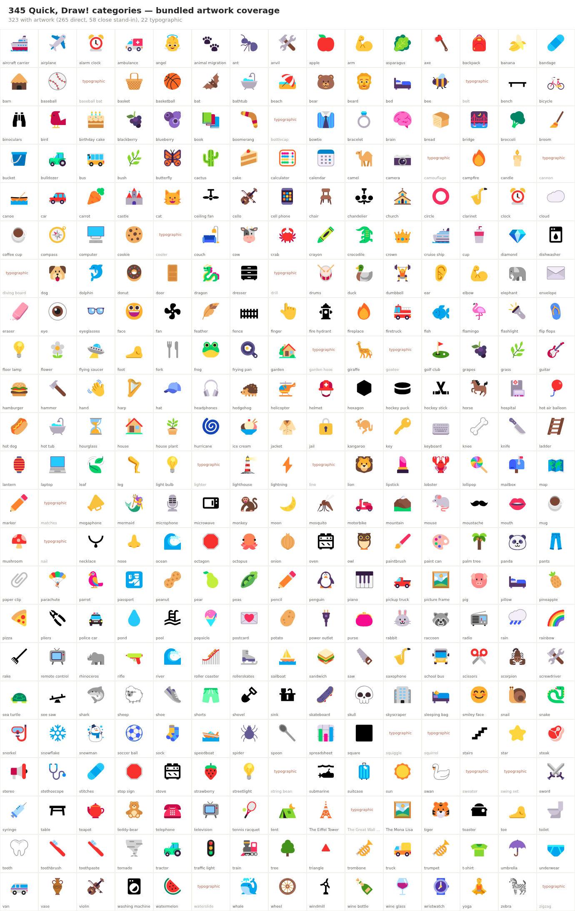

# SketchAI

SketchAI is a small, browser-based drawing studio. Draw a rough object, see a
pretrained neural network's top guesses and their confidence scores, and accept
a clean illustration as an editable scene object. No account, backend,
API key, or paid service is required. Your drawing stays in your browser.

## Features

- Mouse, trackpad, stylus and touch input with separate select, pencil and eraser tools, colors and brush size.
- Local AI recognition after a 600 ms pause; the top 10 probabilities drive a
  horizontally scrollable strip of up to 10 clean suggestion cards.
- "AI thinks you might be drawing…" framing: the panel reports the model's
  uncertainty (for example `Cat 54% · Dog 31% · Tiger 8%`) instead of claiming a
  certain answer.
- Accepted illustrations are structured scene objects, not flattened pixels:
  select, move, proportionally resize, rotate, recolor, duplicate, flip, reorder
  one layer at a time, and delete them independently.
- Undo/redo covers sketching, erasing, object edits and clear. History keeps the
  most recent 24 completed actions. Use Ctrl/Cmd+Z to undo and Ctrl/Cmd+Shift+Z
  or Ctrl/Cmd+Y to redo.
- PNG download/export is intentionally not part of the product. The workspace
  prioritizes keeping clean artwork editable instead of flattening it into a file.
- A short “How it works” explanation for a school demonstration.

## Technologies used

React, Vite, JavaScript, TensorFlow.js and the HTML Canvas API. Lucide provides
the vector icons.

## The AI model

SketchAI can run two classifiers. The **345-class model** is SketchAI's own: it
was trained for this project on Google's Quick, Draw! dataset and is used
whenever its files are present. The **100-class fallback** below is a
third-party model and takes over automatically if the 345-class files are
missing, incomplete or fail validation.

### The 345-class model (trained for this project)

This is **SketchAI's classifier trained on the Google Quick Draw dataset**. It is
*not* Google's model, not AutoDraw and not a third-party checkpoint: every weight
was produced by `training/train_345.py` in this repository.

| | |
| --- | --- |
| Files | `public/model-345/model.json` + `public/model-345/group1-shard1of1.bin` (0.83 MB, one shard) |
| Dataset | [Google Quick, Draw!](https://github.com/googlecreativelab/quickdraw-dataset) — CC BY 4.0, © Google, Inc. |
| Data access path | `quickdraw.js@1.0.6` npm package (MIT wrapper redistributing the official dataset). The canonical Google Cloud Storage bucket and Hugging Face were both unreachable from the training environment, so this mirror was used instead; its own licence file carries the CC BY 4.0 attribution to Google. |
| Examples per class | **100** — the maximum that mirror provides (34,500 drawings total, not the full 50 M) |
| Split | 27,600 train / 3,450 validation / 3,450 test, stratified per class, `SEED = 42` |
| Input | `[1, 28, 28, 1]` float32, white ink on black, values 0–1 |
| Output | 345 softmax probabilities |
| Parameters | 214,649 |
| Test accuracy | **top-1 37.7% · top-3 58.1% · top-10 76.1%** (held-out split; random baseline 0.29%) |
| Hand-drawn doodles | top-1 7/16 · top-3 9/16 · top-10 12/16 on 16 hand-drawn test doodles |

Architecture (unchanged from the design target):

```
Conv2D(32, 3×3, same) → BatchNorm → ReLU → MaxPool(2×2)
Conv2D(64, 3×3, same) → BatchNorm → ReLU → MaxPool(2×2)
Conv2D(128, 3×3, same) → ReLU
GlobalAveragePooling2D → Dense(256, relu) → Dropout(0.4) → Dense(345, softmax)
```

Preprocessing is the same pipeline the browser runs (`src/ai/preprocess.js`,
profile `"345"`): find the ink bounding box, take a centred square
`max(w, h) × 1.186`, area-average it into 28×28, then lift the 97th-percentile
ink value to 1.0 (minimum gamma 0.25). The source bitmaps were re-normalised
into exactly that geometry before training, so training and inference see the
same thing.

Training used Adam (lr 1e-3) with `EarlyStopping`, `ReduceLROnPlateau` and
`ModelCheckpoint`, batch size 128, 60 epochs (best at 57) on a **CPU-only**
machine (no GPU) with TensorFlow 2.21.0 / Python 3.11 — about 12.5 minutes.
Augmentation was light translation and rotation (±5%, ±2.9°) plus deliberate
**pen-width invariance**: Quick, Draw! strokes are ~1.5 px wide on the 28×28
grid, while a browser pen on SketchAI's 1200×720 canvas is only ~0.3–0.6 px, so
each training image was randomly thickened, thinned or gamma-shifted. Without
that, the model scored 41.9% top-1 on the clean test split but only 9/16 top-10
on real hand-drawn doodles; with it the doodle score rose to 12/16.

See [Training our own 345-class model](#training-our-own-345-class-model) for how
to reproduce it, and `training/export/model-345/ATTRIBUTION.txt` for the
attribution shipped alongside the weights.

**Fallback model (bundled).** SketchAI does not redistribute a model it trained
here; the bundled one is pretrained:

| | |
| --- | --- |
| File | `public/model/model.json` + `public/model/group1-shard1of1.bin` (~0.5 MB) |
| Source | [Aniket Dogra's GuessTheDoodle](https://github.com/AniketDogra/GuessTheDoodle) (MIT, © 2019 Aniket Dogra) |
| Format | Keras 2.2.4 `Sequential` CNN exported with the TensorFlow.js converter 1.2.6 |
| Input | `[1, 28, 28, 1]` float32, white ink on black, values 0–1 |
| Output | 100 softmax probabilities (`Dense(100, activation="softmax")`) |
| Labels | `public/model/classes.txt`, one class per line, in model-output order |
| Dataset | [Google Quick, Draw!](https://github.com/googlecreativelab/quickdraw-dataset) 28×28 grayscale bitmaps, up to 5,000 images per class (CC BY 4.0) |

Architecture (from `model.json`, verified against the author's training notebook):

```
Conv2D(16, 3×3, relu, valid) → MaxPool(2×2)
Conv2D(32, 3×3, relu, same)  → MaxPool(2×2)
Conv2D(64, 3×3, relu, same)  → MaxPool(2×2)
Conv2D(128, 3×3, relu, same) → MaxPool(2×2)
Flatten → Dense(128, relu) → Dense(100, softmax)
```

It was trained by the model's author with Adam, batch size 256, 10 epochs and
categorical cross-entropy. The class order in `classes.txt` is the order the
model's 100 outputs were trained with; SketchAI loads the list from the same
release as the weights and refuses to run if the two disagree on class count.
The displayed percentages come straight from the model's softmax output.

### Supported classes (100)

```
drums, sun, laptop, anvil, baseball_bat, ladder, eyeglasses, grapes, book, dumbbell
traffic_light, wristwatch, wheel, shovel, bread, table, tennis_racquet, cloud, chair, headphones
face, eye, airplane, snake, lollipop, power_outlet, pants, mushroom, star, sword
clock, hot_dog, syringe, stop_sign, mountain, smiley_face, apple, bed, shorts, broom
diving_board, flower, spider, cell_phone, car, camera, tree, square, moon, radio
hat, pizza, axe, door, tent, umbrella, line, cup, fan, triangle
basketball, pillow, scissors, t-shirt, tooth, alarm_clock, paper_clip, spoon, microphone, candle
pencil, envelope, saw, frying_pan, screwdriver, helmet, bridge, light_bulb, ceiling_fan, key
donut, bird, circle, beard, coffee_cup, butterfly, bench, rifle, cat, sock
ice_cream, moustache, suitcase, hammer, rainbow, knife, cookie, baseball, lightning, bicycle
```

Both `flower` and `sun` are in the list. Classes such as `house`, `fish`, `dog`
and `heart` are **not** predicted by this model — it can only answer with one of
the 100 above, which is why an unsupported object is answered with the closest
supported shape.

### Suggestion artwork

Every one of the 345 official categories has metadata (display name, icon key,
tier, source) in `src/data/categories.js`, and 323 of them have a bundled vector
icon in `src/data/icons.js`:

| Tier | Meaning | Count |
| --- | --- | --- |
| A | Icon depicts the object | 265 |
| B | Recognisable stand-in | 58 |
| C | No honest icon — the card shows the category name as typography | 22 |

Icons come from Fluent Emoji Flat (MIT), Noto Emoji (Apache-2.0) and Material
Design Icons (Apache-2.0), bundled locally, no network requests. Categories are
chosen by hand and reviewed against a rendered sheet, because a wrong picture is
worse than no picture. With the 345-class model installed, any of the 345 official
categories can appear; the 100-class fallback narrows that to the 100 classes it
knows.



### Why SketchAI trains its own 345-class model instead of bundling one

All 345 official Quick, Draw! categories need a model with 345 outputs. The obvious
candidate, [yining1023/doodleNet](https://github.com/yining1023/doodleNet)
("DoodleClassifier_345", ~50k drawings per class), was investigated and rejected:

- **License:** the GitHub API reports `license: null`, there is no `LICENSE` file
  in the repository or anywhere in its 26-commit history, and neither the README
  nor the training notebook grants redistribution rights. Copyright therefore
  defaults to all rights reserved, so redistributing its weights is not permitted.
- **Mislabelled order:** its `class_names.txt` is not in the official category
  order, so its output index → name mapping would have had to be derived
  separately. Shipping a guessed mapping could silently mislabel every prediction.
- It also has a malformed first layer, and its training data is described as
  "50k per class" rather than the definitive Quick Draw counts.

A search for an alternative found no browser-ready 345-class model with a
redistribution licence (other Quick, Draw! CNN projects on GitHub carry no licence,
`NOASSERTION`, or ship code only, with no weights). Rather than ignore the licensing
problem just because a repository is public, SketchAI **trains its own** classifier
on the Quick, Draw! dataset itself — the dataset is CC BY 4.0 and explicitly
redistributable, so the resulting weights are ours to ship.

The honest trade-off: the reachable mirror of the dataset provides 100 drawings per
class rather than the tens of thousands available from Google's own bucket, so this
model is trained on 34,500 drawings, not millions. That is why its top-1 accuracy
(37.7%) is below published Quick, Draw! numbers, and why the app shows a ranked
top-10 rather than a single verdict.

The rest of the app is built to be class-count agnostic:

- the full official list of 345 categories lives in
  `src/data/quickdraw-categories.txt` (CC BY 4.0), with metadata for every class;
- recognition, the panel and the suggestion strip are all class-count agnostic
  (top 10, live count in the status pill);
- the artwork library covers 323 of the 345 categories already.

The 100-class model's own predictions are what you see; nothing is padded or
faked to look like broader coverage.

### Training our own 345-class model

The licensing problem above has a clean solution: **train the model ourselves**
on Google's Quick, Draw! dataset, which *is* clearly licensed (CC BY 4.0). The
complete pipeline lives in [`training/`](training/README.md) and has been run —
the result is the 345-class model described above.

```
training/train_345.py                  the training pipeline (start here)
training/quickdraw_ndjson.py           loads + normalises the real drawings
training/fetch_quickdraw_data.py       downloads the dataset mirror
training/manual_test.py                sixteen hand-drawn doodles -> top 10
scripts/install-model-345.mjs          validate + install a trained model
scripts/audit-app.mjs                  end-to-end app checks (no browser needed)
training/SketchAI_345_Training.ipynb   the same pipeline as a Colab notebook
```

Real Quick, Draw! drawings -> re-normalised into SketchAI's own 28×28 geometry ->
memory-mapped batches (never the whole dataset in RAM) -> a 214,649-parameter CNN
-> TensorFlow.js export -> `public/model-345/`.

Training runs fine on a **CPU**; the run documented above took about 12.5 minutes
without a GPU. `SAMPLES_PER_CLASS` and `QUICK_TEST` are the two switches that
matter, and the category order always comes from
`src/data/quickdraw-categories.txt`, never from a directory listing.

### Two models, one app

| | Primary | Fallback |
| --- | --- | --- |
| Classes | 345 (ours, trained here) | 100 (MIT third-party) |
| Location | `public/model-345/` | `public/model/` |
| Preprocessing | profile `"345"` | profile `"100"` (frozen) |
| Status pill | "AI ready — 345 objects" | "AI ready — 100 objects" |

The 345-class model is tried first. If its files are absent — `public/model-345/`
is not committed, so a plain checkout starts on the fallback — or if any
validation check fails, the app quietly falls back and shows
"Extended AI unavailable — using 100-object model". Drawing, object editing and
undo/redo are unaffected either way. Each model has its own preprocessing
function so the fallback can never be degraded by work on the new one.

## How AI recognition works

A separate transparent canvas tracks the current sketch, so inserted
illustrations never reach the model.

1. **Bounds** – the alpha channel of the sketch canvas is read once, and the
   bounding box of every inked pixel is computed.
2. **Guards** – a blank canvas or an accidental tap (fewer than 240 ink pixels or
   a bounding box under 16 px) is never sent to the network; the panel explains
   that more drawing is needed.
3. **Crop** – a centred square around that box, `1.186 ×` the box's longest side,
   is used. That ratio reproduces the Quick, Draw! rasterisation, where a cartoon
   is scaled to fill about 84% of the 28 × 28 frame. Aspect ratio is preserved,
   and the padding keeps petals, rays, wheels and antennae inside the frame.
4. **Resample** – each of the 28 × 28 cells is an area average of the source
   pixels, so thin strokes fade rather than disappear.
5. **Contrast normalisation** – a browser pen is much thinner (relative to the
   drawing) than the Quick, Draw! pen, which leaves pale, sub-pixel strokes the
   model has never seen. Ink intensities are gamma-corrected so the 97th
   percentile is ~0.9 opaque, restoring the ink density of the training bitmaps
   without moving any geometry.
6. **Inference** – `tf.tensor4d(ink, [1, 28, 28, 1])` is passed to
   `model.predict()` inside `tf.tidy()`, the probabilities are sorted, and the top
   ten are kept. The panel shows the best guess plus four alternatives; the strip
   shows up to ten cards. Scores below 0.5% are shown as `<1%` rather than a
   misleading `0%`, and a best guess under 45% changes the wording to
   “AI isn't completely sure. Maybe:”. WebGL is used when available and the CPU backend
   otherwise.

Recognition is debounced: one prediction runs ~600 ms after drawing stops, and a
new stroke cancels the pending timer, so the interface stays responsive.


These numbers are model confidence scores, **not guaranteed accuracy**. The model
recognises 100 classes and can make mistakes; simple, centered, single-object
doodles tend to work best. Accepted illustrations are rendered deterministically
from the editable scene-object list. A separate temporary sketch canvas feeds the
recognizer, so clean objects never enter the model input and rough drawing never
changes accepted artwork.

## Editable workspace and export decision

Accepted suggestions become structured objects with their artwork variant,
position, size, rotation, color, flip state and layer order. The scene-object
list is the source of truth; the clean-art canvas is only a deterministic render
of that list. The rough sketch remains on a separate temporary layer, and each
completed pointer gesture is one undoable action.

PNG download/export was intentionally removed as a product decision. SketchAI's
workspace is focused on editable scene objects rather than flattening the current
canvas composition into a PNG. There is no download button, export fallback,
transparent-export setting or PNG export helper in the browser editor.

## Inspecting the model input (development only)

Every prediction can be inspected visually. In a development build the
“Preprocessing inspector” appears under the prediction panel; on a deployed build
open `?debug=ai` to show it. It displays the original canvas, the cropped and
centred region, and the exact 28 × 28 grayscale image sent to the network, plus
the detected bounds, crop side, ink peak → gamma and backend.

## Running locally

Requires a recent Node.js LTS release (Node 20 or newer is recommended).

```bash
npm install
npm run dev
```

Open the local URL printed by Vite. Model files and fonts are included in the
application; no inference request or API key is needed. The initial application
and its assets must be served over HTTP, rather than opened directly as a file.

## Building and deploying

```bash
npm run build
npm run preview
```

The static output is in `dist/`. Deploy that folder to Vercel, or publish it to
GitHub Pages (for example using a Pages workflow). Vite uses relative asset paths,
including for the model, so it works under a repository subpath. On Vercel use
`npm run build` as the build command and `dist` as the output directory.
TensorFlow.js ships as its own chunk (`assets/tfjs-*.js`, ~1.6 MB / 250 kB gzipped).

## Audit and measurements

`docs/AI-AUDIT.md` records the recognition audit: how the model and its label
order were verified, the Quick, Draw! rasterisation the preprocessing now
reproduces, before/after measurements across pen widths and drawing sizes, the
problems found, and the application test results.

## Release notes

`docs/RELEASE-345.md` is a historical release record for the 345-category
licensing investigation, top-10 predictions, artwork library and release tests.
It also notes that its PNG export feature has since been intentionally retired.

## Limitations

- The classifier is a small CNN trained on only ~5,000 images per class; it is
  noticeably weaker than Google's Quick, Draw! production model. Expect
  occasional misses, especially for unusual drawing styles.
- 28 × 28 grayscale input means fine detail is lost; texture, colour and small
  features do not contribute to the prediction.
- Only the 100 Quick, Draw! classes above are recognised. Anything else (a house,
  a dog, a fish, a heart) can only be guessed at as a similar supported class —
  in testing, a drawn bus came back as "Car 83%" and a crayon as "Knife 79%".
  Suggestions are therefore useful for supported objects and unreliable for
  everything else; the app never claims a 345-class model.
- The suggestion library is larger than the model: 323 categories have artwork,
  but only the 100 predicted classes can currently surface as cards.
- Recognition looks at the current unfinalised sketch. If two different objects
  are drawn before inserting an illustration, they are classified together.
- Inference time depends on the device: WebGL is fast, the CPU fallback is usable
  but slower.
- Very thick pens on a very small drawing can over-fill the frame; the contrast
  normalisation only repairs strokes that are too thin, not ones that are too fat.

## Model attribution

SketchAI's 345-class classifier is **trained for this project** using Google's
Quick, Draw! dataset. It is not Google's model, not AutoDraw, and not a
third-party checkpoint. SketchAI is not affiliated with or endorsed by Google.

The dataset is Google's; we did not create it and did not draw any of the
training data. Every export ships an `ATTRIBUTION.txt` restating this, and
`training/README.md` documents the dataset source, licence, sample counts,
architecture, preprocessing and measured metrics.

## Credits / licenses

- Model and labels: [GuessTheDoodle](https://github.com/AniketDogra/GuessTheDoodle),
  MIT; the license text is included in `public/model/LICENSE`.
- Category names: Google's official Quick, Draw! category list, CC BY 4.0
  (`src/data/quickdraw-categories.txt`, license text alongside it). We did not
  create the dataset and did not draw the training data.
- Suggestion icons: [Fluent Emoji Flat](https://github.com/microsoft/fluentui-emoji)
  (MIT), [Noto Emoji](https://github.com/googlefonts/noto-emoji) (Apache-2.0) and
  [Material Design Icons](https://github.com/Pictogrammers/MaterialDesignIcons)
  (Apache-2.0), via the Iconify JSON packages. Bundled, not fetched.
- Training data: [The Quick, Draw! Dataset](https://github.com/googlecreativelab/quickdraw-dataset),
  Google, Inc., CC BY 4.0. The dataset itself is not bundled here.
- Interface icons: [Lucide](https://lucide.dev/), ISC license.
- Fonts: DM Sans and DM Serif Display, distributed through
  [Fontsource](https://fontsource.org/), SIL Open Font License 1.1.
- React, Vite and TensorFlow.js are open-source dependencies; see their
  respective package licenses.
