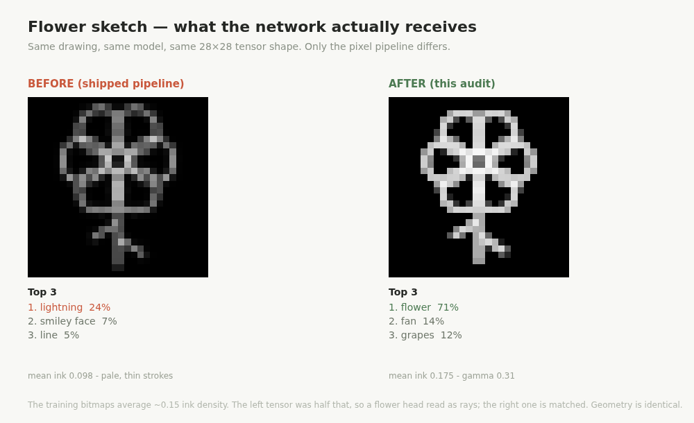

# SketchAI

SketchAI is a small, browser-based drawing studio. Draw a rough object, see a
pretrained neural network's three most likely guesses and their confidence
scores, and add a clean illustration beside your sketch. No account, backend,
API key, or paid service is required. Your drawing stays in your browser.

## Features

- Mouse, trackpad, stylus and touch drawing with pencil, eraser, colors and brush size.
- Local AI recognition after a 600 ms pause; the top three probabilities are shown
  together with matching vector suggestions.
- "AI thinks you might be drawing…" framing: the panel reports the model's
  uncertainty (for example `Cat 54% · Dog 31% · Tiger 8%`) instead of claiming a
  certain answer.
- Add an illustration beside the current sketch, then start drawing another object.
  Suggestions use the current brush color; bold and fine variants change line weight.
- Undo/redo (including insertion and erasing), clear, and PNG export. History keeps
  the most recent 12 states. Use Ctrl/Cmd+Z to undo and Ctrl/Cmd+Shift+Z or
  Ctrl/Cmd+Y to redo.
- A short “How it works” explanation for a school demonstration.

## Technologies used

React, Vite, JavaScript, TensorFlow.js and the HTML Canvas API. Lucide provides
the vector icons.

## The AI model

SketchAI does **not** train a model. It bundles a pretrained doodle classifier:

| | |
| --- | --- |
| File | `public/model/model.json` + `public/model/group1-shard1of1.bin` (~0.5 MB) |
| Source | [Aniket Dogra's GuessTheDoodle](https://github.com/AniketDogra/GuessTheDoodle) (MIT, © 2019 Aniket Dogra) |
| Format | Keras 2.2.4 `Sequential` CNN exported with the TensorFlow.js converter 1.2.6 |
| Input | `[1, 28, 28, 1]` float32, white ink on black, values 0–1 |
| Output | 100 softmax probabilities (`Dense(100, activation="softmax")`) |
| Labels | `public/model/classes.txt`, one class per line, in model-output order |
| Dataset | [Google Quick, Draw!](https://github.com/googlecreativelab/quickdraw-dataset) 28×28 grayscale bitmaps, up to 5,000 images per class (CC BY 4.0) |

Architecture (from `model.json`, verified against the author's training notebook):

```
Conv2D(16, 3×3, relu, valid) → MaxPool(2×2)
Conv2D(32, 3×3, relu, same)  → MaxPool(2×2)
Conv2D(64, 3×3, relu, same)  → MaxPool(2×2)
Conv2D(128, 3×3, relu, same) → MaxPool(2×2)
Flatten → Dense(128, relu) → Dense(100, softmax)
```

It was trained by the model's author with Adam, batch size 256, 10 epochs and
categorical cross-entropy. The class order in `classes.txt` is the order the
model's 100 outputs were trained with; SketchAI loads the list from the same
release as the weights and refuses to run if the two disagree on class count.
The displayed percentages come straight from the model's softmax output.

### Supported classes (100)

```
drums, sun, laptop, anvil, baseball_bat, ladder, eyeglasses, grapes, book, dumbbell
traffic_light, wristwatch, wheel, shovel, bread, table, tennis_racquet, cloud, chair, headphones
face, eye, airplane, snake, lollipop, power_outlet, pants, mushroom, star, sword
clock, hot_dog, syringe, stop_sign, mountain, smiley_face, apple, bed, shorts, broom
diving_board, flower, spider, cell_phone, car, camera, tree, square, moon, radio
hat, pizza, axe, door, tent, umbrella, line, cup, fan, triangle
basketball, pillow, scissors, t-shirt, tooth, alarm_clock, paper_clip, spoon, microphone, candle
pencil, envelope, saw, frying_pan, screwdriver, helmet, bridge, light_bulb, ceiling_fan, key
donut, bird, circle, beard, coffee_cup, butterfly, bench, rifle, cat, sock
ice_cream, moustache, suitcase, hammer, rainbow, knife, cookie, baseball, lightning, bicycle
```

Both `flower` and `sun` are in the list. 39 of these classes have a Lucide
illustration available in the suggestion cards; when a prediction has no
artwork, the app says so rather than inventing one. Classes such as `house`,
`fish` and `heart` are **not** supported by this model.

## How AI recognition works

A separate transparent canvas tracks the current sketch, so inserted
illustrations never reach the model.

1. **Bounds** – the alpha channel of the sketch canvas is read once, and the
   bounding box of every inked pixel is computed.
2. **Guards** – a blank canvas or an accidental tap (fewer than 240 ink pixels or
   a bounding box under 16 px) is never sent to the network; the panel explains
   that more drawing is needed.
3. **Crop** – a centred square around that box, `1.186 ×` the box's longest side,
   is used. That ratio reproduces the Quick, Draw! rasterisation, where a cartoon
   is scaled to fill about 84% of the 28 × 28 frame. Aspect ratio is preserved,
   and the padding keeps petals, rays, wheels and antennae inside the frame.
4. **Resample** – each of the 28 × 28 cells is an area average of the source
   pixels, so thin strokes fade rather than disappear.
5. **Contrast normalisation** – a browser pen is much thinner (relative to the
   drawing) than the Quick, Draw! pen, which leaves pale, sub-pixel strokes the
   model has never seen. Ink intensities are gamma-corrected so the 97th
   percentile is ~0.9 opaque, restoring the ink density of the training bitmaps
   without moving any geometry.
6. **Inference** – `tf.tensor4d(ink, [1, 28, 28, 1])` is passed to
   `model.predict()` inside `tf.tidy()`, the probabilities are sorted, and the top
   three are displayed. WebGL is used when available and the CPU backend
   otherwise.

Recognition is debounced: one prediction runs ~600 ms after drawing stops, and a
new stroke cancels the pending timer, so the interface stays responsive.



These numbers are model confidence scores, **not guaranteed accuracy**. The model
recognises 100 classes and can make mistakes; simple, centered, single-object
doodles tend to work best. Once an illustration is inserted, a new recognition
sketch begins; the existing artwork stays on the canvas, and recognition never
treats all finished objects together as a new sketch.

## Inspecting the model input (development only)

Every prediction can be inspected visually. In a development build the
“Preprocessing inspector” appears under the prediction panel; on a deployed build
open `?debug=ai` to show it. It displays the original canvas, the cropped and
centred region, and the exact 28 × 28 grayscale image sent to the network, plus
the detected bounds, crop side, ink peak → gamma and backend.

## Running locally

Requires a recent Node.js LTS release (Node 20 or newer is recommended).

```bash
npm install
npm run dev
```

Open the local URL printed by Vite. Model files and fonts are included in the
application; no inference request or API key is needed. The initial application
and its assets must be served over HTTP, rather than opened directly as a file.

## Building and deploying

```bash
npm run build
npm run preview
```

The static output is in `dist/`. Deploy that folder to Vercel, or publish it to
GitHub Pages (for example using a Pages workflow). Vite uses relative asset paths,
including for the model, so it works under a repository subpath. On Vercel use
`npm run build` as the build command and `dist` as the output directory.
TensorFlow.js ships as its own chunk (`assets/tfjs-*.js`, ~1.6 MB / 250 kB gzipped).

## Audit and measurements

`docs/AI-AUDIT.md` records the recognition audit: how the model and its label
order were verified, the Quick, Draw! rasterisation the preprocessing now
reproduces, before/after measurements across pen widths and drawing sizes, the
problems found, and the application test results.

## Limitations

- The classifier is a small CNN trained on only ~5,000 images per class; it is
  noticeably weaker than Google's Quick, Draw! production model. Expect
  occasional misses, especially for unusual drawing styles.
- 28 × 28 grayscale input means fine detail is lost; texture, colour and small
  features do not contribute to the prediction.
- Only the 100 Quick, Draw! classes above are recognised. Anything else (a house,
  a fish, a heart) can only be guessed at as a similar supported class.
- Recognition looks at the current unfinalised sketch. If two different objects
  are drawn before inserting an illustration, they are classified together.
- Inference time depends on the device: WebGL is fast, the CPU fallback is usable
  but slower.
- Very thick pens on a very small drawing can over-fill the frame; the contrast
  normalisation only repairs strokes that are too thin, not ones that are too fat.

## Credits / licenses

- Model and labels: [GuessTheDoodle](https://github.com/AniketDogra/GuessTheDoodle),
  MIT; the license text is included in `public/model/LICENSE`.
- Training data: [The Quick, Draw! Dataset](https://github.com/googlecreativelab/quickdraw-dataset),
  Google, Inc., CC BY 4.0. The dataset itself is not bundled here.
- Interface and suggestion icons: [Lucide](https://lucide.dev/), ISC license.
- Fonts: DM Sans and DM Serif Display, distributed through
  [Fontsource](https://fontsource.org/), SIL Open Font License 1.1.
- React, Vite and TensorFlow.js are open-source dependencies; see their
  respective package licenses.
