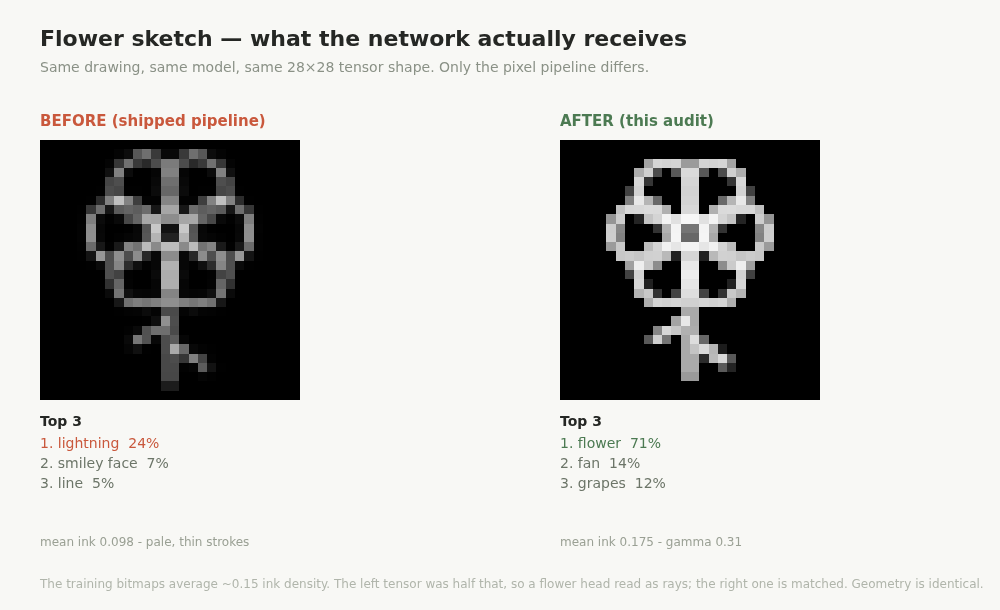

# Historical AI recognition audit — 100-class fallback

**Archive note (2026-11): this is a historical audit of the original third-party
100-class model in `public/model/`, not a report on the current primary
345-class model.** The current app loads the project-trained model from
`public/model-345/` first and falls back to this 100-class model only if the
primary model cannot be loaded or validated. The preprocessing bug investigation
and its 31-doodle measurements below belong to the 100-class model and its
profile; do not apply those numbers to the current primary model. Current model
identity, metrics and a recent small smoke test are in the main
[README](../README.md) and [training guide](../training/README.md).

This document preserves the older engineering audit: what was wrong with the
original fallback path, how preprocessing was changed, and what the historical
test harness measured. Its application-test results and PNG-export notes are
archival; PNG export is not a current capability. The product's current editor
and export decision are documented in the [README](../README.md).

**Historical summary:** the fallback model's original preprocessing was
mismatched. Screen-resolution strokes were being shrunk into near-transparent
sub-pixel lines. The old audit reported that correcting that pipeline improved
its measurements on the audit's synthetic/canonical tests; those figures are
not current primary-model metrics or a broad real-user accuracy guarantee.

## 1. The model

| | |
| --- | --- |
| File | `public/model/model.json` + `public/model/group1-shard1of1.bin` |
| Source | [Aniket Dogra's GuessTheDoodle](https://github.com/AniketDogra/GuessTheDoodle) (MIT) |
| Verified | The bundled `model.json`, weight shard and `classes.txt` are byte-identical to that repository's `model/` directory (checked with `diff` and `md5sum`) |
| Architecture | `Conv2D(16)→Pool → Conv2D(32)→Pool → Conv2D(64)→Pool → Conv2D(128)→Pool → Flatten → Dense(128, relu) → Dense(100, softmax)` |
| Input | `[null, 28, 28, 1]` float32 |
| Output | 100 softmax probabilities |
| Classes | 100 (see README); `flower` is index 40, `sun` is index 1 |

### Label order

`classes.txt` is written in the same order as the training loop assigned labels:
the notebook iterates `classes = f.read().splitlines()` and sets
`labels = np.full(n, id)` where `id` is the enumerate index over the class files,
so output index *N* really is `classes[N]`. SketchAI reads the labels from the
same release as the weights and refuses to load if the model's output width and
the label count disagree.

## 2. What the model expects, and why it mattered

The model was trained on Quick, Draw!'s 28 × 28 numpy bitmaps. Those bitmaps are
generated by rasterising 256 × 256 vector doodles with cairo on a **black**
surface with **white** ink:

```
line_width = 16 (256-space), padding = 16, antialias = best
total_padding = padding * 2 + line_diameter = 48
scale = 28 / (256 + 48) = 0.0921
```

Two consequences:

1. **Geometry** — the drawing's bounding box fills 255 × 0.0921 ≈ 23.5 of 28 px,
   i.e. a margin of ~16% of the frame, and it is centred.
2. **Ink density** — a 16-unit pen becomes ~1.5 px on the 28 px grid, and the
   bitmaps average ~0.15 ink density (values 0–255, divided by 255 at training
   time).

### The bug

The previous pipeline scaled the user's crop straight from a 1200 × 720 canvas
down to 28 × 28 in one `drawImage` and used pixel alpha as intensity, dividing by
255. With a 7 px pen that produces strokes ~0.16 px wide on the target grid:
antialiasing spreads the ink so the *strongest* pixel in the tensor was around
0.35–0.6 instead of 1.0, and the mean density was roughly half the training
distribution. The network was not seeing a weak drawing, it was seeing a nearly
empty one — which is exactly the regime in which a flower head full of radial
petals is read as rays (`sun`, `lightning`).

Measured on the same 31 doodles at several pen widths, before the fix:

| pen width | 3 px | 5 px | 7 px | 10 px | 14 px | 19 px | 24 px |
| --- | --- | --- | --- | --- | --- | --- | --- |
| top-1 (old) | 3% | 3% | 6% | 39% | 65% | 87% | 87% |

Accuracy depended on how thick the pen happened to be — a preprocessing artefact,
not a model limitation.

## 3. The pipeline now

`src/ai/preprocess.js` (no TensorFlow dependency, unit-testable):

1. **Read alpha once.** The sketch canvas (a transparent overlay that holds only
   the current, not-yet-illustrated drawing) is read with one `getImageData`.
   Alpha, not luminance, is used as ink, so any pen colour behaves the same.
2. **Bounding box** of all pixels with alpha > 10, plus ink-pixel and ink-mass
   counts.
3. **Guards.** Fewer than 240 ink pixels, or a box smaller than 16 px, is treated
   as an accidental tap: inference is skipped and the panel asks for more
   drawing. (A 7 px dot ≈ 52 ink pixels; a stray 20 px line ≈ 212; a small 40 px
   doodle drawn with a 3 px pen ≈ 492.)
4. **Crop.** A square centred on the box, `1.186 ×` its longest side — the Quick,
   Draw! ratio (28 / 23.5). Aspect ratio is preserved and the padding keeps
   petals, rays, wheels and antennae in frame.
5. **Area-average to 28 × 28.** Each output cell averages its real coverage, so
   thin strokes fade instead of disappearing.
6. **Contrast normalisation.** A gamma curve lifts ink so the 97th percentile
   reaches 0.9, restoring the density the model was trained on. Geometry is
   untouched; only brightness is remapped. Nothing about *which* class wins is
   hard-coded.
7. **Tensor + inference.** `tf.tensor4d(ink, [1, 28, 28, 1])` inside `tf.tidy()`,
   `model.predict()`, sort, top three. WebGL when present, CPU otherwise.

Verified negative facts: ink is *not* inverted (the model is white-on-black and
the tensor is white-on-black); probabilities are the softmax output of the final
layer, not rescaled logits (a `toProbabilities` guard would convert logits if a
future model needed it); no shape rules, keyword tricks or random values exist
anywhere in the prediction path.



## 4. Test set and results

Because no labelled doodle corpus is bundled, the benchmark uses 31 programmatic
doodles drawn with the same canvas primitives the app uses (round caps, round
joins, 1200 × 720 canvas), rendered at several pen widths (3–24 px), sizes
(120–650 px) and positions (centre and off-centre). They are intentionally
cleaner and more canonical than real hand drawings, so treat the absolute numbers
as an upper bound; the *relative* comparison between pipelines is what matters.

Top-1/top-3 at the app's default 7 px pen, current pipeline:

| pen | 3 px | 5 px | 7 px | 10 px | 14 px | 19 px | 24 px |
| --- | --- | --- | --- | --- | --- | --- | --- |
| top-1 | 71% | 84% | 81% | 77% | 84% | 87% | 84% |

Position and size do not matter much (81% for a drawing 300 px off centre; 74–87%
across sizes), which confirms the crop/centring logic.

### Per-object report (default pen)

| Expected | #1 | #2 | #3 | Result |
| --- | --- | --- | --- | --- |
| Circle | Circle 79% | Moon 17% | Basketball 1% | PASS |
| Square | Square 89% | Bench 5% | Suitcase 3% | PASS |
| Triangle | Triangle 96% | Mountain 3% | Tent 1% | PASS |
| Star | Star 100% | Airplane 0% | Bird 0% | PASS |
| Line | Line 62% | Diving Board 4% | Cloud 2% | PASS |
| Sun | Sun 100% | Light Bulb 0% | Spider 0% | PASS |
| Moon | Moon 99% | Circle 0% | Clock 0% | PASS |
| Smiley Face | Smiley Face 84% | Face 14% | Cookie 1% | PASS |
| Eyeglasses | Eyeglasses 79% | Cloud 17% | Moustache 3% | PASS |
| Flower | Flower 71% | Fan 14% | Grapes 12% | PASS |
| Tree | Flower 85% | Stop Sign 11% | Fan 2% | MISS |
| Car | Car 100% | Eyeglasses 0% | Headphones 0% | PASS |
| Umbrella | Umbrella 98% | Mushroom 1% | Helmet 0% | PASS |
| Clock | Clock 100% | Cookie 0% | Moon 0% | PASS |
| Donut | Donut 100% | Eye 0% | Sun 0% | PASS |
| Ladder | Ladder 100% | Chair 0% | Diving Board 0% | PASS |
| Tent | Tent 90% | Triangle 9% | Dumbbell 0% | PASS |
| Rainbow | Rainbow 100% | Bridge 0% | Helmet 0% | PASS |
| Lightning | Lightning 100% | Syringe 0% | Star 0% | PASS |
| Cloud | Clock 19% | Cookie 18% | Bread 14% | MISS |
| Bicycle | Bicycle 41% | Eyeglasses 27% | Shorts 6% | PASS |
| Cup | Hat 23% | Cup 20% | Square 9% | TOP-3 |
| Apple | Apple 92% | Alarm Clock 4% | Circle 2% | PASS |
| Candle | Candle 100% | Suitcase 0% | Syringe 0% | PASS |
| Mushroom | Mushroom 85% | T-Shirt 7% | Bread 5% | PASS |
| Pizza | Triangle 98% | Tent 2% | Dumbbell 0% | MISS |
| Key | Key 86% | Eyeglasses 6% | Spoon 5% | PASS |
| Cat | Cat 91% | Alarm Clock 6% | Beard 2% | PASS |
| Butterfly | Butterfly 97% | Grapes 1% | Ceiling Fan 1% | PASS |
| Bird | Hat 38% | Helmet 36% | Bread 5% | MISS |
| Book | Diving Board 33% | Square 25% | Door 22% | MISS |
top-1 25/31, top-3 26/31

`Tree` is my own test doodle's fault (three overlapping circles on a stick look
like a flower head); `Pizza` is a plain triangle with no toppings, which is
genuinely ambiguous; `Cloud`, `Bird` and `Book` are the model's real weak spots.

## 5. Problems found and fixed

| Problem | Impact | Fix |
| --- | --- | --- |
| Ink far too pale after downscaling (no density normalisation) | Main cause of misrecognition, flower → sun | Gamma normalisation to a 0.9 ink peak |
| Single `drawImage` downscale averaged poorly | Thin strokes faded to nothing | Explicit area-averaged rasteriser on the alpha channel |
| Padding 1.12 instead of the training ratio 1.19 | Drawing filled too much of the frame | `CROP_PADDING = 1.186` |
| No minimum-ink guard | Predictions for dots and stray taps | 240 ink pixels / 16 px span threshold with its own UI message |
| Output width never validated against the label count | A label/model mismatch would silently mislabel everything | `loadModel()` throws if they disagree |
| No backend fallback | A browser without WebGL failed to load the model | Capability probe + CPU fallback |
| Raw inference errors reached React state as `[]` only | Users saw a stale "waiting" panel | Friendly message, developer log, app keeps working |
| `saveHistory()` could throw on a blocked pixel buffer | Unhandled exception on pointer-up | Guarded; drawing continues without that history entry |
| Displayed scores assumed to be probabilities | Would be meaningless for a logit model | `toProbabilities()` converts logits if needed |
| Certain-sounding UI ("AI predictions") | Overstated accuracy | "AI thinks you might be drawing…" plus a confidence footnote |

No model replacement was needed (situation **A: model is good, preprocessing was
wrong**).

## 6. Application testing

Ran against the real components in Node with a skia-backed canvas (the renderer
Chromium uses) and a jsdom DOM:

- **Unit/model**: 31 doodles × 7 pen widths × 5 sizes/positions; blank, tiny,
  huge; pale vs dark pen; tensor/memory probes (12 live tensors and flat RSS over
  600 consecutive predictions).
- **UI**: 45 checks — drawing, undo/redo (stroke-level, erase, clear, insertion),
  colour and size controls, suggestions, illustration insertion, PNG download
  (1200 × 720, opaque white, non-blank), tiny-sketch guard, helper modal, and the
  preprocessing inspector.
- **Input**: 13 checks — pointer mapping at devicePixelRatio 2 and a 390 px wide
  layout, touch pointer type, debounce timing, stale-result cancellation,
  injected pixel-read failure (friendly message, no stack trace, recovery).
- **Failure modes**: 9 checks — 404 model, corrupt model JSON, recovery.
- **Production**: 6 + 6 checks running the built bundle from a subpath
  (`/sketchai/`), including the `?debug=ai` gate.

Known gaps: no real browser was available in this environment (missing system
libraries), so WebGL execution, real GPU timing and real touch hardware were not
exercised; the CPU backend and the DOM/canvas layers were. Visual layout was not
re-checked beyond structure.

## 7. Reproducing

```bash
npm install
npm run dev      # ?debug=ai or a dev build shows the preprocessing inspector
npm run build
```

The benchmark harness itself is not part of the app; it loads `src/ai/*` and the
bundled model directly.
