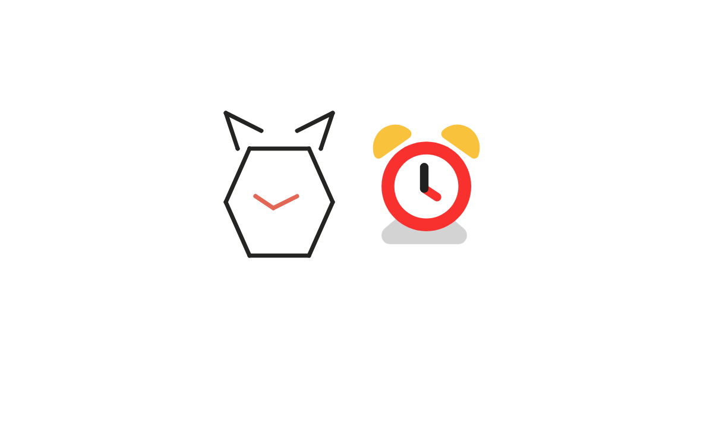
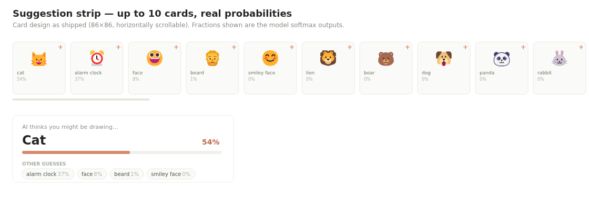
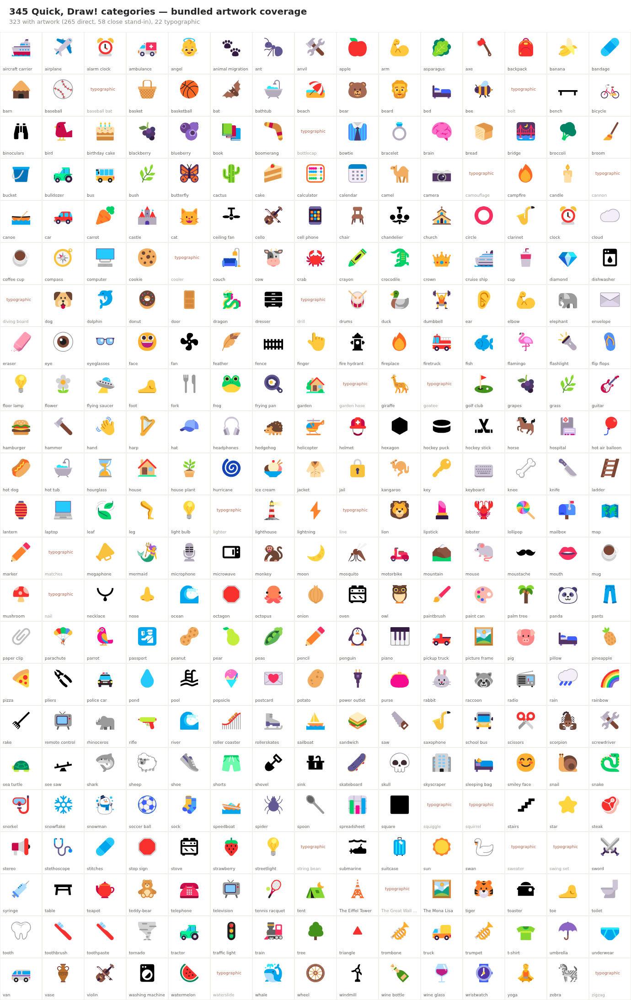

# Functional upgrade release notes

This release covers: the PNG export repair, the 345-category investigation and
its outcome, top-10 predictions, the expanded suggestion artwork library, and the
full test results. The recognition audit from the previous release is in
[AI-AUDIT.md](AI-AUDIT.md).

## 1. Download

**Root cause.** The export produced a `data:` URL and called `link.click()` on an
anchor that was never attached to the document, with no error handling. That
combination fails or silently does nothing in several real browsers:
Chrome refuses top-frame navigation to long data URLs, Firefox and older Safari
ignore clicks on detached anchors, and sandboxed embeds need
`allow-downloads`. There was no fallback path, so a failure looked like a dead
button. The early round of automated tests passed because the DOM harness
recorded the anchor regardless of whether the browser would honour it.

**Fix** (`src/lib/download.js`):

- an explicit export canvas composites every *visible* layer (user strokes +
  inserted illustrations) and never the temporary recognition overlay;
- white background by default, with an opt-in transparent export;
- `canvas.toBlob()` → `blob:` object URL → anchor attached to the DOM → click →
  cleanup;
- a data-URL fallback when `toBlob` returns `null` or throws, and `atob`-based
  Blob construction if `toBlob` is missing entirely;
- a manual “Save the PNG again” link if the browser still blocks the download;
- readable failure message and a disabled button while saving.

**Real PNG test.** The produced file was decoded and inspected, not just
asserted on: 1200 × 720, fully opaque, white background, dark strokes, terracotta
strokes from a second colour and the inserted illustration all present, and
sampled pixels match the visible canvas exactly.

## 2. The 345-class question

The requested candidate, [yining1023/doodleNet](https://github.com/yining1023/doodleNet),
was investigated in full:

| Check | Result |
| --- | --- |
| Files exist | yes — `model-tfjs/` and `demo/DoodleClassifier_345/model/` (2.1 MB shard) |
| TF.js compatible | yes — loads, input `[null,28,28,1]`, output `[null,345]`, softmax |
| Class order | **its `class_names.txt` is not the official 345 order** |
| Preprocessing | same Quick, Draw! 28 × 28 bitmaps the current model uses |
| Model size | 2,126 KB weights (4.3× the current 126,564 → 544,201 parameters) |
| Load time | ~11 ms (Node CPU backend), inference ~14 ms median |
| **Licence** | **none** — GitHub `license: null`, no LICENSE file in 26 commits, nothing in the README or notebook |

Because there is no licence, redistributing those weights is not permitted.
Searching for an alternative found no browser-ready 345-class model under a
redistribution licence (the other Quick, Draw! CNN repositories are
`NOASSERTION`, unlicensed, or code-only with no weights).

**Decision: do not bundle it.** Instead the release implements everything that is
independent of the model's class count, so a licensed 345-class model can be
dropped in later without UI changes:

- `src/data/quickdraw-categories.txt` — the verified official 345-category list
  (reproduced from Google's list; the PyTorch mirror
  `XJay18/QuickDraw-pytorch`, Apache-2.0, was used as a cross-check and matches
  exactly, including order);
- `src/data/categories.js` — `{modelLabel, displayName, icon, iconSource, tier}`
  metadata for all 345;
- top-10 prediction handling, a suggestion strip that scales to any class count,
  and a status pill that reports the live class count.

The shipped model keeps its 100 classes and its measured accuracy; nothing is
padded to simulate coverage.

## 3. Accuracy

Measured with the shipped model and the corrected preprocessing (same test set as
[AI-AUDIT.md](AI-AUDIT.md)):

| Metric | Value |
| --- | --- |
| Top-1 (31 canonical doodles, 7 px pen) | 81% |
| Top-3 | 84% |
| Top-10 | 87% |
| Top-1 range across 3–24 px pens | 71–87% |

Top-10 is only 3 points above top-3 with 100 classes, because a small, confident
model rarely spreads mass across ten labels. The extra card slots therefore show
low-probability guesses (displayed as `<1%` rather than `0%`), which is honest
but not very useful — with 345 classes the tail would carry real signal. This is
one more reason the 345-class model matters.

### Requested manual test set (rough doodles, hand wobble applied)

### REQUESTED TEST SET (expected object -> model output)

| Expected | In 100-class set? | Top 1 | Top 3 | Top 10 | Confidence |
| --- | --- | --- | --- | --- | --- |
| Flower | yes | Flower 86% | yes | yes | 86% |
| Sun | yes | Sun 100% | yes | yes | 100% |
| Cat | yes | Cat 97% | yes | yes | 97% |
| Dog | NO | Face 81% | no | no | 81% |
| Fish | NO | Cloud 79% | no | no | 79% |
| House | NO | Bread 57% | no | no | 57% |
| Car | yes | Car 100% | yes | yes | 100% |
| Bus | NO | Car 83% | no | no | 83% |
| Tree | yes | Cloud 27% | yes | yes | 27% |
| Airplane | yes | Airplane 83% | yes | yes | 83% |
| Clock | yes | Clock 100% | yes | yes | 100% |
| Umbrella | yes | Umbrella 92% | yes | yes | 92% |
| Shoe | NO | Diving Board 46% | no | no | 46% |
| Guitar | NO | Dumbbell 21% | no | no | 21% |
| Elephant | NO | Sun 36% | no | no | 36% |
| Lion | NO | Sun 42% | no | no | 42% |
| Train | NO | Shorts 29% | no | no | 29% |
| Bird | yes | Hat 39% | no | no | 39% |
| Apple | yes | Apple 88% | yes | yes | 88% |
| Butterfly | yes | Butterfly 92% | yes | yes | 92% |

supported by the bundled model: 11/20 | top-1 9/11, top-3 10/11, top-10 10/11

### RANDOM CATEGORIES THE CURRENT MODEL CANNOT PREDICT AT ALL

| Expected | In 100-class set? | What the model guessed instead | Confidence |
| --- | --- | --- | --- |
| Basket | NO | Suitcase | 27% |
| Harp | NO | Beard | 50% |
| Dragon | NO | Drums | 21% |
| Swan | NO | Cloud | 33% |
| Wheat | NO | Flower | 74% |
| Crayon | NO | Knife | 79% |
| Bread | yes | Beard | 23% |
| Spoon | yes | Lollipop | 89% |
| Boot | NO | Sock | 85% |
| Hand | NO | Door | 23% |

Random categories the current model **cannot** predict at all (chosen from the
345, verified absent from `classes.txt`) show it answering with the nearest
supported shape: basket → Suitcase 27%, harp → Beard 50%, dragon → Drums 21%,
swan → Cloud 33%, wheat → Flower 74%, crayon → Knife 79%, boot → Sock 85%,
hand → Door 23%. This is the honest cost of a 100-class model.

## 4. Visual suggestions

- Up to **10** cards per prediction cycle, ordered by real softmax probability.
- **323 of 345** categories have bundled artwork (265 direct, 58 recognisable
  stand-ins); **22** use the typographic fallback because no honest icon exists
  (e.g. camouflage, squiggle, zigzag, garden hose, nail).
- Cards show the illustration, the category label and the model's probability;
  text-only cards are non-interactive so a click never inserts a wrong picture.
- Clicking a card inserts the clean artwork into the drawing layer, and it
  participates in undo, redo, clear and PNG export like any other stroke.

## 5. Performance

| Measurement | Value |
| --- | --- |
| Model weights | 494 KB + 6 KB manifest, cached by the browser |
| App bundle | index 423 KB (152 KB gzip), react 138 KB, tfjs 1,554 KB (243 KB gzip) |
| Icon library | 376 KB raw inside the app bundle (≈130 KB gzip) |
| Model load + init | ~10 ms (CPU backend, Node); dominated by the network fetch |
| Inference | mean 12 ms, median 9 ms, p95 54 ms (CPU, Node) |
| Tensors after 25 predictions | 12 (flat — `tf.tidy()` is doing its job) |

## 6. Build

- `npm run dev` — clean; verified endpoints for `/src/*`, `/model/*`.
- `npm run build` — clean, no warnings; vendor chunks split (`react`, `tfjs`).
- Production bundle executed in a DOM harness from a subpath (`/sketchai/`),
  including the `?debug=ai` gate — model loads and a flower is recognised.

## 7. Test summary

| Suite | Checks | Result |
| --- | --- | --- |
| Core UI (draw, undo/redo, eraser, colours, clear, insert, help) | 46 | pass |
| Pointer/touch/DPR/debounce/failure recovery | 13 | pass |
| Model failure modes (404, corrupt, recovery) | 9 | pass |
| PNG export (compositing, blob, fallbacks, transparency, failure) | 23 | pass |
| Top-10 predictions and suggestion strip | 23 | pass |
| Download re-test with two colours + inserted artwork | 10 | pass |
| Production bundle (default and `?debug=ai`) | 6 + 6 | pass |

Known gaps: no real browser or GPU was available in this environment, so WebGL
execution, real download UX and real touch hardware were exercised through a
skia-backed canvas + jsdom harness rather than a browser.
